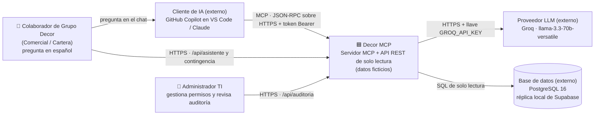
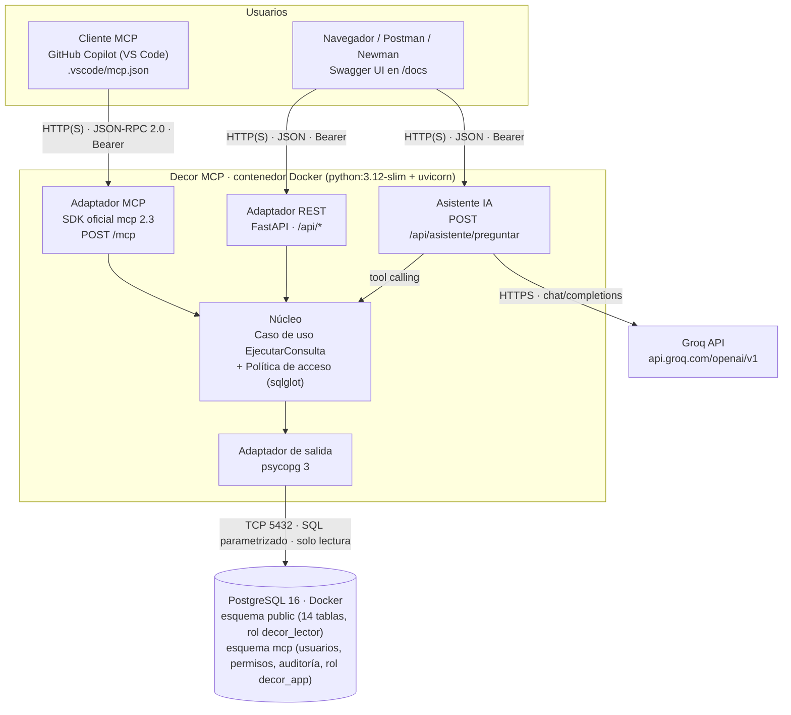

# Arquitectura – Decor MCP

Documentación de la arquitectura con el **modelo C4** (niveles 1 y 2). Los diagramas están en Mermaid,
así que GitHub los dibuja y se versionan igual que el código. Los niveles 3 y 4 (componentes y código)
no se dibujan: la estructura hexagonal ya se ve en las carpetas de `app/` (ver sección 2 del README).

Decisiones de arquitectura: [ADR-001 · Stack](adr/ADR-001-stack.md) · [ADR-002 · Base de datos y despliegue](adr/ADR-002-base-de-datos-y-despliegue.md) ·
[ADR-08 a ADR-12 (Módulo 3)](decisiones-implementacion.md).

## Nivel 1 · Diagrama de contexto

Quién usa el sistema y con qué sistemas externos habla.

| Elemento | Tipo | Responsabilidad |
|---|---|---|
| Colaborador | Persona | Hace preguntas de negocio en lenguaje natural (facturas, pedidos, cartera, existencias). |
| Administrador TI | Persona | Habilita tablas por usuario (`mcp.permisos`) y revisa la auditoría. |
| Decor MCP | Sistema (este repo) | Expone 8 herramientas de solo lectura, aplica la Política de acceso y audita cada llamada. |
| Cliente de IA | Sistema externo | Copilot o Claude usan las herramientas por MCP. |
| Groq | Sistema externo | LLM que usa el asistente integrado (`/api/asistente/preguntar`) para elegir herramientas y redactar la respuesta. |
| PostgreSQL | Sistema externo | 14 tablas de negocio con datos ficticios + esquema interno `mcp`. |

## Nivel 2 · Diagrama de contenedores

Las piezas que se despliegan, con su tecnología y el protocolo de cada flecha.

| Contenedor | Tecnología | Archivo |
|---|---|---|
| Adaptador MCP | SDK `mcp` 2.3, transporte Streamable HTTP | `app/adaptadores/entrada/servidor_mcp.py` |
| Adaptador REST | FastAPI + OpenAPI | `app/adaptadores/entrada/api_rest.py` |
| Asistente IA | `httpx` → Groq (API compatible con OpenAI) | `app/adaptadores/entrada/asistente_ia.py` |
| Núcleo | Python puro (sin dependencias de infraestructura) | `app/aplicacion/`, `app/dominio/` |
| Adaptador PostgreSQL | psycopg 3 | `app/adaptadores/salida/postgres.py` |
| Base de datos | PostgreSQL 16 (Docker) | `database/` |

## Verificación contra el código

Los diagramas se generaron con IA a partir de la estructura del proyecto y de `requirements.txt`, y luego se revisaron contra el código:

1. **Sin frontend propio.** La única interfaz web es Swagger UI (`/docs`); no se dibuja un contenedor "frontend" porque no existe en el repo.
2. **El cliente de IA nunca toca la base.** Toda consulta pasa por el servidor (Política de acceso + auditoría); por eso no hay flecha IA → base de datos.
3. **SMTP fuera del diagrama.** El notificador de correo está en el diseño del Módulo 2 pero no está implementado (pendiente en el README), así que no se muestra.
