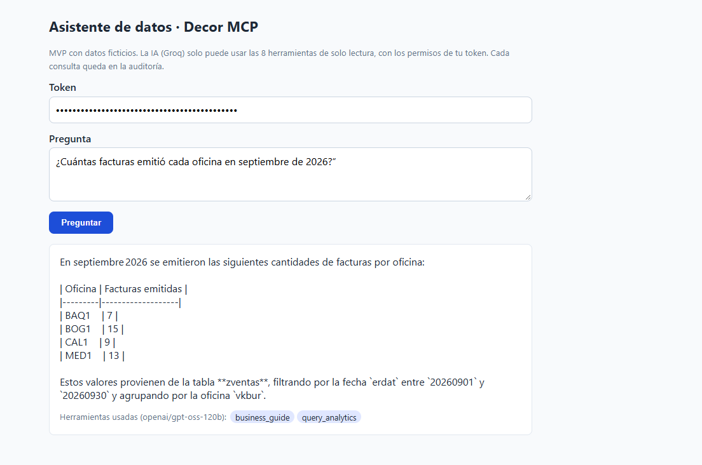
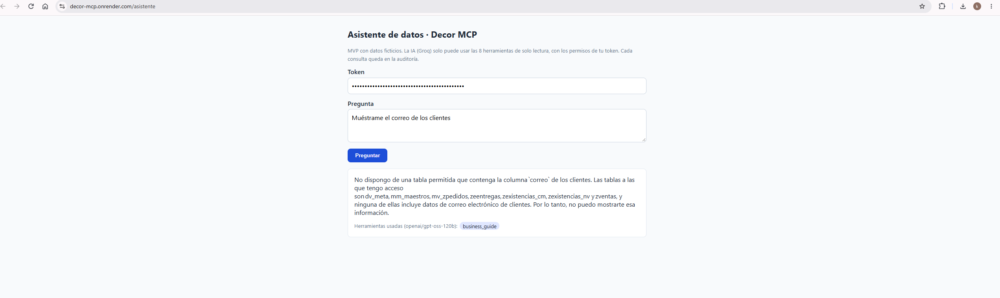
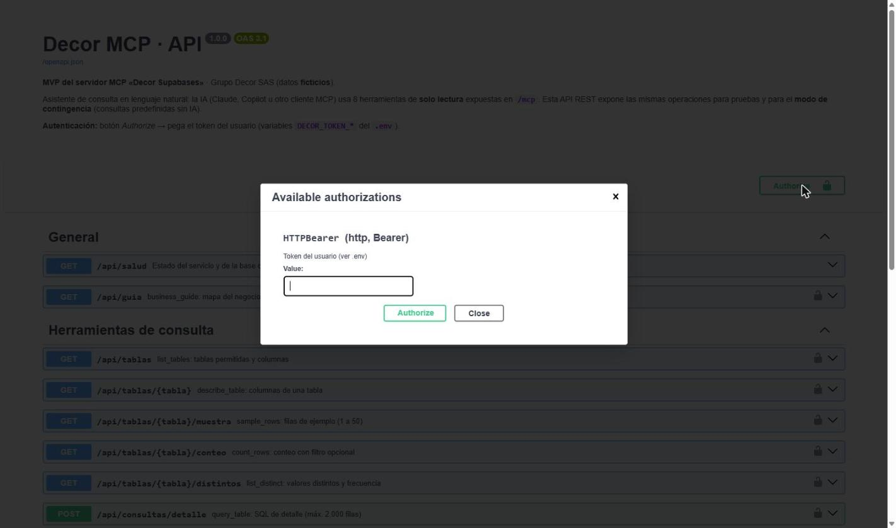
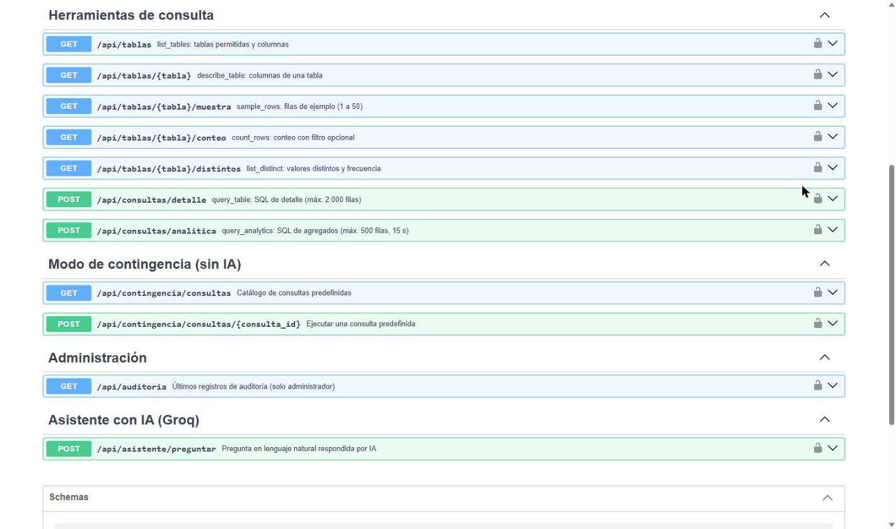

# Manual de usuario – Decor MCP

Guía para usar el asistente de datos de Grupo Decor (MVP con **datos ficticios**).
Dirección pública: **https://decor-mcp.onrender.com**

> El servicio usa el plan gratuito de Render: si nadie lo usa en 15 minutos se "duerme" y la primera
> respuesta puede tardar hasta 1 minuto. Es normal.

## 1. ¿Qué puedo hacer?

| Quiero… | Dónde | Necesito IA |
|---|---|---|
| Preguntar en español, por ejemplo "¿cuántas facturas emitió cada oficina en septiembre?" | Página **/asistente** | Sí (Groq) |
| Preguntar desde VS Code con GitHub Copilot | Endpoint **/mcp** (ver README, sección 6) | Sí (Copilot) |
| Consultar sin IA, con consultas ya preparadas | **/docs** → *Modo de contingencia* | No |
| Ver quién consultó qué (solo administrador) | **/docs** → *Administración* | No |

## 2. Antes de empezar: tu token

El token es tu "llave" personal: identifica quién eres y qué tablas puedes ver. TI lo entrega a cada persona.
En la demo hay tres usuarios:

| Usuario | Puede ver | No puede ver |
|---|---|---|
| Comercial | Ventas, pedidos, entregas, materiales, existencias | Datos personales de clientes, cartera |
| Cartera | Cartera y facturas | Pedidos, existencias, datos personales |
| Administrador | Todas las tablas y la auditoría | — |

No compartas tu token ni lo escribas en correos o chats.

## 3. Usar el asistente con IA (`/asistente`)

1. Abre **https://decor-mcp.onrender.com/asistente**.
2. En **Token** pega tu token.
3. En **Pregunta** escribe lo que necesitas saber (máximo 500 caracteres).
4. Dale **Preguntar** y espera unos segundos.

Debajo de la respuesta aparecen las **herramientas que usó la IA** (por ejemplo `business_guide` y
`query_analytics`). Así sabes que la cifra salió de la base de datos y no fue inventada.

**Preguntas de ejemplo**

- ¿Cuántas facturas emitió cada oficina en septiembre de 2026?
- ¿Cuántos pedidos están abiertos y cuánto suman?
- ¿Cuál es el material con más existencias en Decorcerámica?

**Si pides algo que tu usuario no puede ver**, la IA te lo explica y no muestra los datos:

## 4. Consultar sin IA: modo de contingencia (`/docs`)

Úsalo si el asistente responde "Error 503" (la IA no está disponible) o si prefieres resultados exactos sin redactar preguntas.

1. Abre **https://decor-mcp.onrender.com/docs**.
2. Dale **Authorize**, pega tu token en *Value*, luego **Authorize** y **Close**.

   

3. Baja a **Modo de contingencia (sin IA)**.

   

4. Abre `GET /api/contingencia/consultas` → **Try it out** → **Execute** para ver el catálogo.
5. Abre `POST /api/contingencia/consultas/{consulta_id}` → **Try it out**, escribe el id y los parámetros, y dale **Execute**.

| Id | Qué responde | Parámetros (ejemplo) |
|---|---|---|
| `facturacion-oficina-mes` | Facturas y valor neto de una oficina en un mes | `{"parametros": {"oficina": "BOG1", "mes": "202609"}}` |
| `pedidos-estado` | Pedidos por estado en un rango de fechas | `{"parametros": {"oficina": "BOG1", "desde": "2026-09-01", "hasta": "2026-09-30"}}` |
| `existencias-material` | Existencias de un material por canal | `{"parametros": {"material": "MAT100001", "canal": "TODOS"}}` |
| `cartera-vencida-cliente` | Saldo y valor vencido de un cliente | `{"parametros": {"cliente": "CLI2005", "fecha_corte": "2026-10-31"}}` |
| `pqr-oficina` | PQR por oficina y estado | `{"parametros": {"oficina": "BOG1", "estado": "ABIERTA"}}` |
| `puntos-decorclub` | Puntos de un socio DecorClub | `{"parametros": {"documento": "912345678"}}` |

Oficinas válidas: `BOG1`, `MED1`, `CAL1`, `BAQ1`. Cada consulta respeta los permisos de tu token.

## 5. Administrador de TI

- **Ver la auditoría:** en `/docs`, con el token de administrador, `GET /api/auditoria` → *Try it out* → *Execute*.
  Cada consulta muestra quién, cuándo, por qué canal (`MCP`, `REST`, `CONTINGENCIA`, `ASISTENTE_IA`) y si fue `OK`, `DENEGADA` o `ERROR`.
- **Dar acceso a una tabla:** insertar una fila en `mcp.permisos` (correo, tabla). No hay que volver a desplegar.
- **Tokens y llave de IA en la demo:** Render → servicio *decor-mcp* → *Environment* (`DECOR_TOKEN_*`, `GROQ_API_KEY`, `DECOR_GROQ_MODELO`).

## 6. Mensajes de error y qué hacer

| Mensaje | Qué significa | Qué hacer |
|---|---|---|
| Error 401 | Falta el token o no es válido | Pega el token completo, sin espacios |
| Error 403 / "no está habilitada" | Tu usuario no tiene permiso para esa tabla | Pide acceso a TI |
| Error 422 | La pregunta está vacía o supera 500 caracteres | Escribe una pregunta más corta |
| Error 503 | La IA no está disponible o alcanzó su límite | Espera un minuto o usa el modo de contingencia (sección 4) |
| La página tarda ~1 minuto | El servicio gratuito estaba "dormido" | Espera; las siguientes respuestas son rápidas |

## 7. Preguntas frecuentes

**¿La IA puede borrar o cambiar datos?** No. Las 8 herramientas son de solo lectura y la base usa un rol que solo puede leer.

**¿La IA ve toda la base?** No. Solo ve las tablas que permite tu token; la regla está en el servidor, no en la IA.

**¿Los datos son reales?** No. Toda la información es ficticia (Ley 1581 de 2012).
